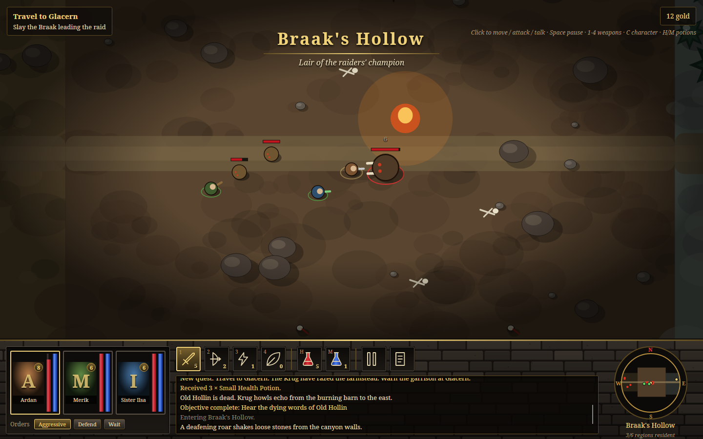
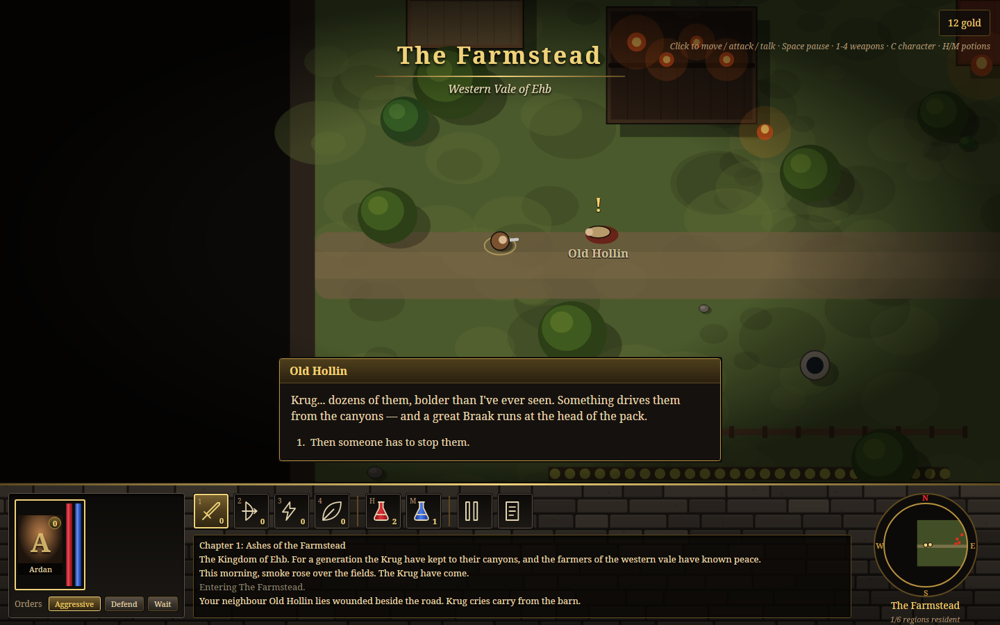
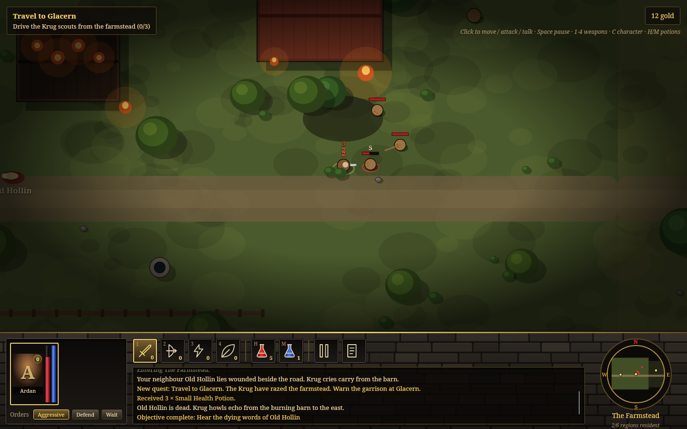
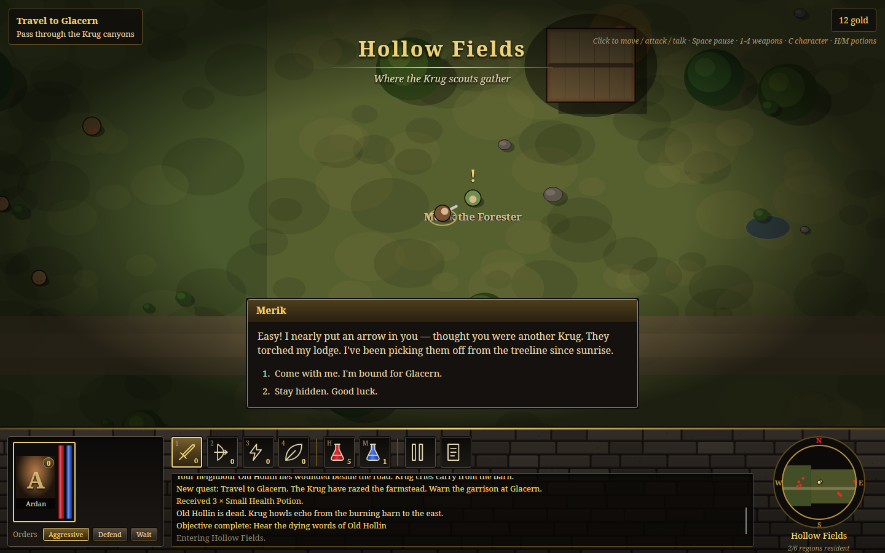
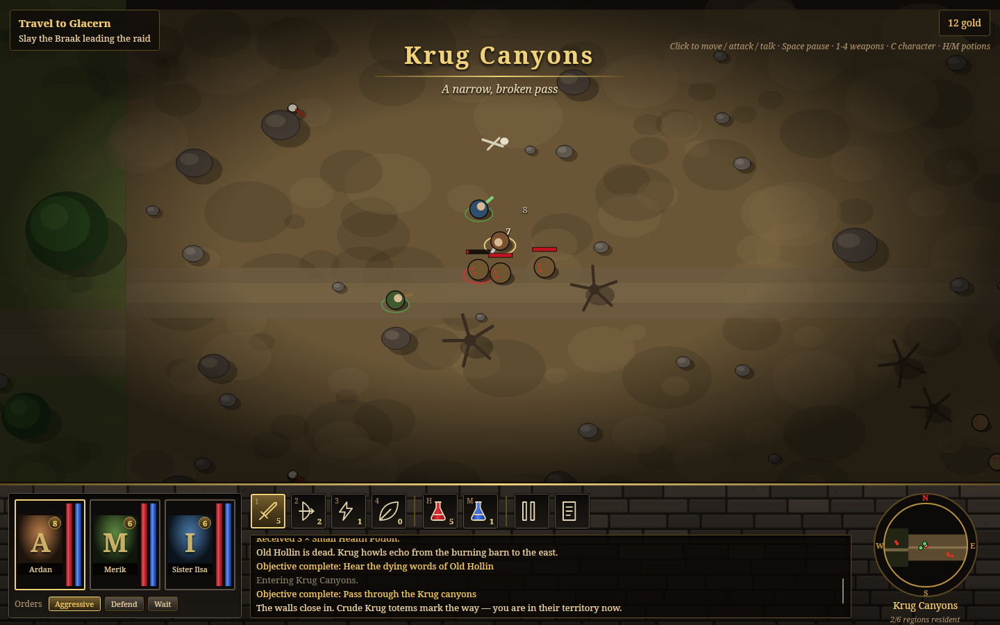
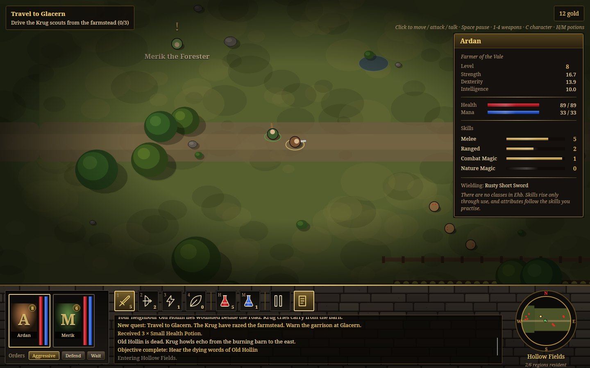
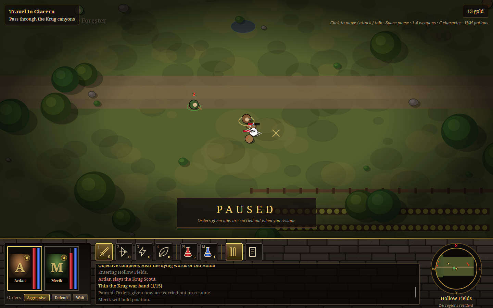
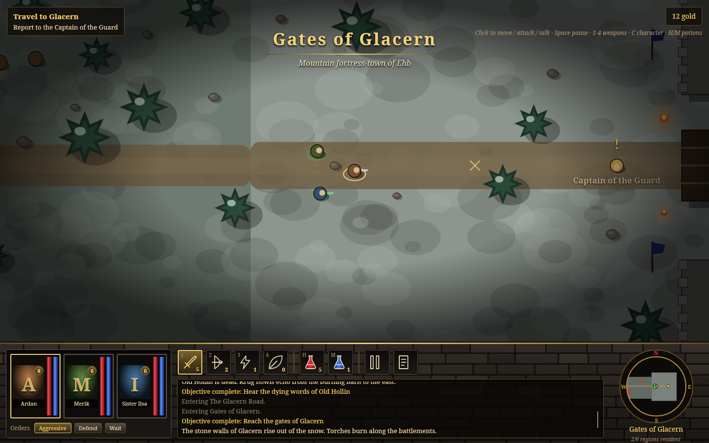
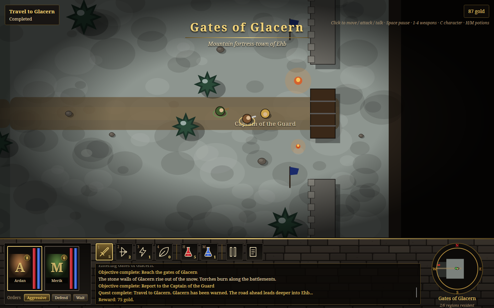

# AVADungeonSeige

A cross-platform recreation of the look, feel and opening chapter of **Dungeon Siege** (2002) in
C# / .NET 10 (LTS) and Avalonia 12: real-time, pausable party combat, a classless skills-by-use
character system, and one continuous world that streams in around you with no loading screens.



## Screenshots

| | |
|---|---|
|  |  |
| The farmstead burns: Old Hollin's last words | First blood at the barn |
|  |  |
| Recruiting Merik in Hollow Fields | The Krug Canyons: no loading screen, just a title card |
|  |  |
| Character sheet: skills rise by use | Paused, with orders queued for the resume |
|  |  |
| The Gates of Glacern | Quest complete |

The screenshots are rendered by the real window without a display: `tools/screenshots.sh`
regenerates them all (`tests/DungeonSiege.App.Tests/ReadmeScreenshots.cs` sets up each scene).
Each scene uses a fixed seed and is played frame by frame at 30 frames a second, and the camera
follows simulated time rather than the wall clock. A rerun gives the same pictures, so only a real
change to the game's look shows up in git.

## Contents

- [Download and run](#download-and-run)
- [The game](#the-game): story, the road to Glacern, the quest, the party, the bestiary, arms and spells
- [How it plays](#how-it-plays): pausable real time, classless progression, party orders, combat, the seamless world
- [Controls](#controls) and [the HUD](#the-hud)
- [Solution layout](#solution-layout), [architecture](#architecture) and [content data / modding](#content-data-and-modding)
- [Building](#building), [testing](#testing), [technical details](#technical-details), [roadmap](#roadmap), [licence](#licence)

## Download and run

Every push is built and tested by GitHub Actions (`.github/workflows/build.yml`), which then
publishes AVADungeonSeige as **one self-contained executable** (no .NET install needed) for:

| | x64 (Intel / AMD) | ARM64 |
|---|---|---|
| **Windows** | `win-x64` | `win-arm64` (Snapdragon / Surface) |
| **macOS** | `osx-x64` (Intel Macs) | `osx-arm64` (Apple silicon) |
| **Linux** | `linux-x64` | `linux-arm64` (Raspberry Pi 4/5, ARM laptops and servers) |

Each build is attached to its workflow run. The newest build of `main` is also on the **latest**
pre-release, and tagging a commit `v*` (e.g. `v0.1.0`) makes a proper release. Windows builds come
as `.zip` files; macOS and Linux builds come as `.tar.gz` files, which keep the executable bit.
Unpack one and run `AVADungeonSeige` (`AVADungeonSeige.exe` on Windows). The chapter's content,
the Skia renderer and the HarfBuzz text shaper are all inside that one file.

Notes:
- **macOS:** the builds are not signed, so the first run needs right-click → **Open**, or
  `xattr -d com.apple.quarantine AVADungeonSeige`.
- **Linux:** if the file lost its executable bit on the way, run `chmod +x AVADungeonSeige`. You
  need a desktop session (X11 or Wayland) with fontconfig, which every mainstream desktop has.
- **Fonts:** the interface asks for **Cinzel** (or Trajan) for its carved-stone headings and falls
  back to Palatino, Book Antiqua, Georgia, Noto Serif or Liberation Serif. Installing Cinzel (free,
  from Google Fonts) gives the intended look.

To play from source: `dotnet run --project src/DungeonSiege.App`. [Building](#building) covers
making the release executables yourself.

## The game

### Story

*The Kingdom of Ehb. For a generation the Krug have kept to their canyons, and the farmers of the
western vale have known peace. This morning, smoke rose over the fields. The Krug have come.*

You are **Ardan**, a farmer. You begin on the road outside your farmstead with a rusty sword, a
hunting bow and nothing else to your name. The neighbour's house is burning and Krug cry out from
the barn. Old Hollin lies wounded beside the road. With his last breath he tells you to warn the
garrison at **Glacern**, far to the east beyond the Krug canyons. A great **Braak** runs at the
head of the raiders.

### The road to Glacern

The vale is one continuous space, laid out west to east. The six regions below are only the units
it streams in by (see [The seamless world](#the-seamless-world)). Walking from one to the next
shows only a title card.

| Region | Subtitle | What's there |
|---|---|---|
| **The Farmstead** | Western Vale of Ehb | Your burning neighbour's house, a barn, a well and the crop rows. Old Hollin lies dying by the road. Three Krug Scouts and a Krug Grunt raid the barn. |
| **Hollow Fields** | Where the Krug scouts gather | Burned cottages and fields. **Merik the Forester** hides at the treeline. A scout pack is in the south field and two grunts stand by the road. |
| **Krug Canyons** | A narrow, broken pass | A tight, boulder-strewn pass marked with Krug totems and bones. Grunts hold the pass, scouts hold the ridge, and there is a Krug camp with a tent and fire at the far end. |
| **Braak's Hollow** | Lair of the raiders' champion | The war camp: tents, a banner, totems and a great fire. **The Braak** waits here with two grunt bodyguards. |
| **The Glacern Road** | Frost on the foothills | Snowy pine foothills. **Sister Ilsa** keeps a glowing wayshrine; she tends your wounds and can join you. The Krug's last ambush lies ahead. |
| **Gates of Glacern** | Mountain fortress-town of Ehb | Stone walls, an iron-banded gate, torches and banners. The **Captain of the Guard** waits for your news. |

There are 27 enemies on the road: 14 Krug Scouts, 12 Krug Grunts and the Braak.

### The quest: Travel to Glacern

| # | Objective | How it's met |
|---|---|---|
| 1 | Hear the dying words of Old Hollin | Talk to Old Hollin. He starts talking on his own once you come within 6 paces. |
| 2 | Drive the Krug scouts from the farmstead | Slay 3 Krug Scouts |
| 3 | Pass through the Krug canyons | Enter the Krug Canyons |
| 4 | Slay the Braak leading the raid | Kill the Braak in Braak's Hollow |
| — | *Thin the Krug war band (optional)* | Slay 15 Krug of any kind |
| 5 | Reach the gates of Glacern | Enter the Gates of Glacern |
| 6 | Report to the Captain of the Guard | Talk to the captain |

The quest tracker (top left) always shows the first unfinished required objective, with a count
where there is one. Hollin gives you 3 Small Health Potions when you take up the quest. Finishing
it pays **75 gold**.

### The party

Up to 8 can travel together; Chapter 1 offers two companions. All of them start with every attribute
at about 10 and grow from there by what they do (see [Classless progression](#classless-progression)).

| | Who | Starts with | Str / Dex / Int | Starting skills | Default orders |
|---|---|---|---|---|---|
| **Ardan** | Farmer of the Vale (you) | Rusty Short Sword, Hunting Bow, *Zap*, *Healing Hands* | 11 / 10 / 9 | none | Aggressive |
| **Merik** | Forester, found hiding in Hollow Fields | Yew Longbow, Skinning Knife | 10 / 13 / 9 | Ranged 3, Melee 1 | Defend |
| **Sister Ilsa** | Keeper of the Wayshrine on the Glacern Road | *Healing Hands*, *Zap*, Oak Staff | 9 / 10 / 14 | Nature 3, Combat 1 | Defend |

Ardan carries something for all four skills on purpose: nothing stops a farmer from becoming an
archer or a mage. To recruit a companion, click them to talk and accept. Recruited companions
leave the map (the world remembers) and join your portraits.

### Bestiary

| | Krug Scout | Krug Grunt | **Braak** (boss) |
|---|---|---|---|
| Description | Wiry raiders that skirmish ahead of the war band, hurling crude spears | Brutish foot soldiers with clubs and stolen farm tools | A hulking, tusked beast the Krug have goaded into leading their raid |
| Health / armour | 18 / 0 | 32 / 1 | 150 / 2 |
| Damage | 1–3, **thrown spear**, 7 paces | 2–5, melee | 5–11, melee, 2 paces |
| Attack every | ~2.0 s | ~1.5 s | ~2.2 s |
| Speed | 4.3 (fast) | 3.6 | 3.2 |
| Notices you at / gives up past | 12 / 28 paces | 10 / 26 | 12 / 35 |
| Experience | 12 | 20 | 120 |
| Gold | 1–4 | 2–8 | 25–40 |
| Drops a health potion | 12 % | 15 % | always |

Enemies **hunt in packs**: when one spots you, its spawn-mates within 10 paces join in. Hitting
one from out of its sight provokes it all the same. Chased too far from home, an enemy gives up,
walks back and heals to full. Every enemy attack is rolled a little faster or slower (±15 %), so
a pack doesn't strike in lockstep.

### Arms, spells and potions

| Item | Kind | Trains | Power | Reach | Every | Mana |
|---|---|---|---|---|---|---|
| Rusty Short Sword | Weapon | Melee | 3–6 | 1.4 | 1.1 s | |
| Skinning Knife | Weapon | Melee | 2–4 | 1.2 | 0.8 s | |
| Oak Staff | Weapon | Melee | 2–5 | 1.7 | 1.3 s | |
| Hunting Bow | Weapon | Ranged | 2–5 | 11 | 1.5 s | |
| Yew Longbow | Weapon | Ranged | 3–7 | 13 | 1.7 s | |
| *Zap* | Spell | Combat Magic | 4–8 damage | 10 | 1.6 s | 4 |
| *Healing Hands* | Spell | Nature Magic | 8–13 healing, on the most hurt ally | 9 | 2.0 s | 6 |
| Small Health Potion | Potion | | +40 health | | | |
| Small Mana Potion | Potion | | +30 mana | | | |

You start with 2 health potions, 1 mana potion and 12 gold. Potions are shared from the party's
pack and drunk by the selected character.

## How it plays

### Real time, pausable

The world runs in real time, and **Space** (or **P**) freezes it instantly. While paused you can
still do everything: select party members, change their weapons and orders, drink potions, click
to queue moves, attacks or conversations. Each order is carried out the moment you resume, as in
the original. The pause plate at the bottom of the view and the lit pause button on the belt
show the state. Dialogue also stops the clock.

Under the hood the simulation advances in **fixed 30 Hz steps** whatever the frame rate. A long
frame (for example while dragging the window) is capped at 0.25 s rather than letting the
simulation run away to catch up. So gameplay is identical on a 30 Hz laptop and a 144 Hz monitor.

### Classless progression

There are no classes in Ehb. **Skills rise only through use**, and **attributes rise with the
skills you use**, as in Dungeon Siege:

| Using... | ...trains | Each skill level adds |
|---|---|---|
| a sword, knife or staff | **Melee** | **+1.0 Strength**, +0.35 Dexterity |
| a bow | **Ranged** | +0.35 Strength, **+1.0 Dexterity** |
| *Zap* | **Combat Magic** | +0.15 Dexterity, **+1.0 Intelligence** |
| *Healing Hands* | **Nature Magic** | +0.15 Strength, **+1.0 Intelligence** |

- **Experience** goes only to the skill of the item used: half the damage dealt on every hit, the
  enemy's experience value on the killing blow, and 0.8 × the health restored by a heal.
- **Next level** needs `25 × (level + 1)^1.45` experience (25, 68, 123, 187, 258, ...).
- **Character level** is the sum of the four skill levels (Dungeon Siege's "uber level"). It is
  the gold badge on each portrait.
- **Derived stats:** max health `20 + 3·Str + Dex + 0.5·Int`, max mana `5 + 2.5·Int + 0.25·Dex`,
  speed `5.2 + 0.01·Dex`. When a level-up raises a maximum, current health and mana rise with it.
- **Power** of any weapon or spell is scaled by `1 + 0.04 × (attribute − 10) + 0.03 × skill level`,
  where the attribute is Strength for melee, Dexterity for ranged and Intelligence for magic.

Every level-up is announced in the log with its attribute gains, e.g. *"Ardan's Melee rises to
5! (+1 Str, +0.35 Dex)"*. A gold ring and floating text appear in the world, and the character
sheet (**C**) shows each skill's progress bar and experience.

### Party orders

Click a portrait (or **F1–F8**) to select a character. The selected character is the **leader**:
your clicks command them, the camera follows them, and the others keep a wedge formation behind
them. Each character has fight orders, set from the **Orders** buttons under the portraits:

| Order | Picks fights with... | Chases? | Follows the leader? |
|---|---|---|---|
| **Aggressive** | any enemy within 12 paces (or weapon reach + 2) that is within 22 of the leader | yes | yes |
| **Defend** | enemies already attacking the party within 12 of the leader, or anything in weapon reach | yes, but held to the leader | yes |
| **Wait** | only what comes into weapon reach | no | no: holds position |

Characters readied with *Healing Hands* act as healers instead. They keep the party alive by
healing whoever is below 70 % health, worst first. A spellcaster who runs out of mana draws their
melee weapon (or bow) on their own and says so in the log. Nobody wanders more than 24 paces from
the leader.

### Combat

- **Click an enemy** to attack it, **an NPC** to walk over and talk, or **the ground** to move. The
  cursor becomes a crosshair over enemies and a hand over NPCs, and hovering an enemy shows its
  name and health.
- Armour is subtracted from every hit, but every hit does at least 1 damage.
- Damage numbers float up: white for your hits, red for hits on the party, green for heals and
  gold for coins and level-ups. Sword strikes show as white slashes, arrows and spears fly, *Zap*
  arcs as blue lightning, and heals rise in green motes.
- Enemy health bars appear once an enemy is hurt or hunting you; the Braak's always shows.
- **Unconscious, not dead:** a character brought to 0 health falls unconscious. Once no hunting
  enemy is within 15 paces for 6 seconds, they get up again with a quarter of their health.
- **Party wipe:** if everyone is down, the party wakes at the farmstead with half health and the
  Krug go home. Nothing is lost.
- **Recovery:** out of combat, health regenerates at `1.2 + 0.05·Str` per second and mana at
  2.5× its in-combat rate of `0.4 + 0.04·Int` per second. In a fight, health only trickles back.
- Dead Krug leave their bodies for 30 seconds. Their gold goes straight into the party purse
  (top right).

### The seamless world

Dungeon Siege's signature was that you never saw a loading screen. Here the whole chapter is one
coordinate space; `WorldStreamer` keeps a **streaming bubble** around the leader:

- A region is **loaded** (its props scattered, enemies spawned and NPCs placed) once the leader is
  within **45 paces** of its edge, long before any of it can be seen.
- It is **unloaded** when the leader is more than **70 paces** away. The gap between 45 and 70
  stops the game from loading and unloading a region over and over when you walk back and forth
  along its edge.
- What happened is remembered in `WorldState`, which outlives the regions: dead enemies stay dead
  when you come back, recruited companions don't reappear, and title cards and story triggers
  fire only once.

The renderer only ever draws what is loaded, so the edge of what you see really is the streaming
bubble. The status line under the minimap shows the count, e.g. *"3/6 regions resident"*.

## Controls

| Input | Action |
|---|---|
| **Left-click** ground / enemy / NPC | Move / attack / walk over and talk (the selected character) |
| **Mouse wheel** | Zoom the view in and out |
| **Space** or **P** | Pause / resume |
| **1 – 4** | Ready the Melee, Ranged, Combat Magic or Nature Magic slot |
| **F1 – F8** | Select party member 1–8 |
| **H** / **M** | Drink a health / mana potion (selected character) |
| **C** | Character sheet |
| **Esc** | Close the character sheet |
| **1 – 9** in a conversation | Choose that reply (or click it) |

Every HUD button can also be clicked; the belt, potion, pause and sheet buttons have tooltips naming their keys.

## The HUD

```
┌────────────────────────────────────────────────────────────────────────────────────────────┐
│ ┌─Quest tracker──────────┐          Region title card                  ┌─Purse─┐          │
│ │ Travel to Glacern      │        ═══════════════════                   │87 gold│          │
│ │ Slay the Braak ...     │           subtitle                           └───────┘ key hints│
│ └────────────────────────┘                                                  ┌─Character──┐ │
│                              W O R L D   V I E W                            │ sheet (C)  │ │
│                     (streamed regions, y-sorted props and actors,           └────────────┘ │
│                      combat effects, floating numbers, vignette)                           │
│                            ┌─Dialogue / PAUSED plate─┐                                     │
├════════════════════════════════════ gold trim ═════════════════════════════════════════════┤
│ ┌Portraits─────────────┐ [Swd1][Bow2][Zap3][Heal4] │ [H][M] │ [||][Sheet]     ╭─N─╮        │
│ │ [A]▌▌ [M]▌▌ [I]▌▌    │ ┌─Action log────────────────────────────────┐    W│map│E       │
│ │  red=health blue=mana│ │ story · combat · skills · loot · quests   │      ╰─S─╯        │
│ │ Orders: Aggr Def Wait│ └───────────────────────────────────────────┘  Region, streaming │
└────────────────────────────────────────────────────────────────────────────────────────────┘
```

- **Left:** a portrait for each party member, with a level badge and a "Unconscious" overlay.
  Beside each portrait are glossy vertical **ruby (health)** and **sapphire (mana)** vials, and
  below them the leader's **Orders**.
- **Centre:** the weapon/spell belt, with skill level badges and the active slot lit gold. Next
  come the potions with their counts, then the pause and character-sheet buttons. Below them is
  the **action log**, coloured by kind: parchment for story, rust for combat, green for skills,
  amber for loot and gold for quests.
- **Right:** a circular, north-up **minimap** in a gold compass ring, centred on the leader. It
  shows visited regions, the road, enemies (red; the boss is larger), NPCs (gold) and the party
  (green, with the leader in gold). Below it are the region name and the streaming status.

The whole look is built from styles and control themes; no bitmaps are involved. The palette has
dark stone greys, earth browns, tarnished gold, ruby and sapphire. Buttons are chiselled stone
slabs, the belt slots are deep inset sockets, and the windows have gold title bars. The masonry
behind the HUD is generated by code (`StoneBackdrop`), and the world, minimap and icons are drawn
in code as well.

## Solution layout

```
AVADungeonSeige.slnx
├─ src/DungeonSiege.Core        Pure engine, no UI dependency at all
│   ├─ Characters/              Actor, Character (attributes, derived stats, progression), Skill, AttributeGrowth
│   ├─ Parties/                 Party (roster, leader, wedge formation), CombatBehavior, Move/Attack/Talk orders
│   ├─ World/                   WorldStreamer (the streaming bubble), RegionInstance, WorldState, Enemy, Npc, Prop
│   ├─ Engine/                  GameSession (fixed-step loop, commands, scripting) + GameSession.Simulation (AI, combat)
│   ├─ Quests/  Dialogue/  Items/
│   └─ Content/                 Data contracts, ContentDatabase (loader + validation), Data/*.json (Chapter 1)
├─ src/DungeonSiege.App         Avalonia 12 front end (MVVM with CommunityToolkit.Mvvm) → AVADungeonSeige(.exe)
│   ├─ Views/                   MainWindow (game loop, keys), MainView (the world view and the HUD)
│   ├─ Controls/                WorldView, MinimapView, StoneBackdrop: custom DrawingContext renderers
│   ├─ ViewModels/              MainViewModel, PartyMemberViewModel, belt/potion/orders/dialogue items
│   ├─ Themes/                  Palette, ControlThemes (stone button, slot, portrait, jewel bars, stone window), HudStyles, Icons
│   └─ Services/GameLoop.cs     ~60 Hz frame clock on the UI thread
├─ tests/DungeonSiege.Core.Tests   xUnit: content, progression, pause/fixed step, quests, streaming, orders
├─ tests/DungeonSiege.App.Tests    Headless UI tests on the real window, plus the README screenshots
├─ tools/screenshots.sh         Regenerates screenshots/
├─ build.sh / build.ps1         Publish all six platforms to BUILDS/
└─ .github/workflows/build.yml  CI: build, test, publish, release
```

Dependencies flow one way: `App → Core` and `Tests → Core`. The Core project references no UI
packages, so the whole game (quests, combat, streaming and progression) runs and is tested
without a window.

## Architecture

- **Engine and UI are separate.** `GameSession` owns a play-through and knows nothing about
  Avalonia. A host calls `Advance(elapsed)` once a frame, issues commands (`Interact`,
  `SetBehavior`, `SetActiveSkill`, `UseItem`, `ChooseDialogue`, `TogglePause`) and reads state back.
  The engine reports what happened through three events: `MessageLogged`, `RegionEntered` and
  `PauseChanged`. It also keeps lists of short-lived `CombatEffect` and `FloatingText` items for
  the renderer to draw.
- **One thread, polled.** The game loop ticks on the UI thread, so the engine needs no locks.
  `MainViewModel.Tick` advances the session and refreshes the HUD's view models; a property only
  notifies when its value actually changed. The two custom-drawn views are told to redraw every
  frame; everything else is ordinary data binding.
- **Determinism.** All the game's randomness comes from one seeded `Random` (seed 2002 by
  default), and time advances only in fixed steps. A session given the same seed and the same
  commands at the same steps plays out identically, which is what makes the screenshot tests
  repeatable.
- **Immediate-mode rendering.** `WorldView` draws ground and ground texture, flat props (roads,
  crops, scorch marks, bones), then props and actors sorted by Y so nearer things overlap farther
  ones. Effects, floating text and a vignette go on top. Immutable brushes and pens are cached, so
  drawing a frame creates almost none.

## Content data and modding

Chapter 1 is entirely data: seven JSON files in `src/DungeonSiege.Core/Content/Data/`, embedded
in the program. JSON comments and trailing commas are allowed.

| File | Holds |
|---|---|
| `chapter1.json` | Title, intro text, protagonist, start position, starting items and gold |
| `characters.json` | Party templates: attributes, starting skills, a loadout with one item per skill slot, active slot, orders |
| `enemies.json` | Enemy templates: health, armour, damage, reach, ranged or not, speed, aggro and leash radii, experience, gold, potion chance, size, colour, tags, rank |
| `items.json` | Weapons, spells (damage or heal) and potions |
| `regions.json` | Bounds, ground colours, a seed, placed props, scattered props, enemy spawns, NPCs, enter triggers |
| `dialogue.json` | Dialogue trees: nodes with a speaker and text; choices with a next node and actions |
| `quests.json` | Quests: objectives of type `Talk`, `Kill`, `Reach` or `Flag`, each with a target and count (optionally optional); completion text and gold |

Dialogue choices run **script actions**:

| Action | Effect |
|---|---|
| `quest.start:<quest>` | Start a quest |
| `recruit:<character>` | The template joins the party where the NPC stood; the NPC leaves the map for good |
| `give:<item>[:<count>]` | Add items to the party pack |
| `gold:<n>` | Add gold |
| `flag:<name>` | Set a world flag (and satisfy any `Flag` objective) |
| `heal` | Restore the whole party, reviving anyone unconscious |
| `story:<text>` | Write a story line to the log |

Kill objectives match an enemy's id **or any of its tags** (`krug` covers scouts and grunts).
`ContentDatabase` checks every cross-reference at load time: protagonist, loadout items, spawn
enemies, NPC and trigger dialogues, and the start node and choice targets of every dialogue. A
typo fails at startup with a list of every problem rather than mid-chapter.
`ContentDatabase.LoadFromDirectory` reads the same files from a folder on disk, which is the hook
for mods and designer iteration.

## Building

Requires the **.NET 10 SDK**.

```
dotnet build                                   # everything
dotnet run --project src/DungeonSiege.App      # play from source
dotnet test                                    # all tests
```

**Release executables:** `./build.sh` (macOS / Linux) or `./build.ps1` (Windows PowerShell)
publishes all six platforms into `BUILDS/`. The scripts can cross-compile, so any one machine can
build all six.

| Folder | Runtime | Output |
|---|---|---|
| `BUILDS/WINDOWSx64` | `win-x64` | `AVADungeonSeige.exe` |
| `BUILDS/WINDOWSarm64` | `win-arm64` | `AVADungeonSeige.exe` |
| `BUILDS/MACOSx64` | `osx-x64` | `AVADungeonSeige` |
| `BUILDS/MACOSarm64` | `osx-arm64` | `AVADungeonSeige` |
| `BUILDS/LINUXx64` | `linux-x64` | `AVADungeonSeige` |
| `BUILDS/LINUXarm64` | `linux-arm64` | `AVADungeonSeige` |

Each folder holds the single executable and nothing else: about 45–50 MB, self-contained and
compressed. The single-file settings live in `src/DungeonSiege.App/DungeonSiege.App.csproj` and
switch on whenever a runtime identifier is given. So a plain publish for one platform does the
same thing:

```
dotnet publish src/DungeonSiege.App -c Release -r osx-arm64 -o publish/osx-arm64
```

(`SelfContained`, `PublishSingleFile`, `IncludeNativeLibrariesForSelfExtract`,
`IncludeAllContentForSelfExtract` and `EnableCompressionInSingleFile` are all on. Debug symbols,
including the native `.pdb` files the SkiaSharp and HarfBuzz packages would otherwise leave beside
the executable, are dropped.)

## Testing

```
dotnet test                       # 31 tests: engine and headless UI
./tools/screenshots.sh            # regenerate screenshots/ (headless, deterministic)
```

- **`DungeonSiege.Core.Tests`** cover the following:
  - The embedded chapter loads, passes validation, and its regions join into one walkable strip.
  - Each skill raises its own primary attribute most and leaves the other skills alone; level-ups
    raise maximum and current health; character level is the sum of the skills.
  - Pausing stops time but keeps queued orders; 60 fps and 20 fps hosts simulate the same steps.
  - Approaching Hollin starts the quest and gives the potions.
  - Regions stream in and out; killed spawns stay dead after a reload.
  - A companion on Wait holds position; talk and move orders complete.
- **`DungeonSiege.App.Tests`** drive the real `MainWindow` through Avalonia's headless platform
  with real Skia rendering. They check the portraits, belt slots, pause plate, dialogue and quest
  tracker, and that the window renders a frame. They also render the README screenshots: each
  scene is played frame by frame from the fixed seed and captured with `CaptureRenderedFrame`.
  Nothing is written unless `AVADS_README_SHOTS` names a folder; the script sets it.

## Technical details

- **Framework:** .NET 10 (LTS), C# latest, nullable references on, central package management
  (`Directory.Packages.props`)
- **UI:** Avalonia 12.1 with the Fluent theme as the base under custom `ControlTheme`s and styles,
  compiled bindings
- **Pattern:** MVVM with CommunityToolkit.Mvvm source generators (`[ObservableProperty]`,
  `[RelayCommand]`)
- **Rendering:** custom `Control.Render(DrawingContext)` views on Skia; no image assets
- **Simulation:** fixed 30 Hz step and a 60 Hz UI-thread frame clock; frame time capped at 0.25 s
- **Data:** System.Text.Json; content is embedded and checked at load
- **Tests:** xUnit (engine), xUnit v3 + Avalonia.Headless.XUnit (UI)
- **CI:** GitHub Actions builds and tests, then publishes six single-file builds and keeps a
  rolling `latest` pre-release

## Roadmap

- Chapter 2 and beyond: the crypts and deeper Ehb, more Krug, and new kinds of creature
- An inventory with equipment slots and loot drops beyond gold and potions, and a pack mule
- More spells for each school, and spell books
- Saving and loading (`WorldState` already holds what persists)
- Sound and music
- Pathfinding around obstacles (movement is currently straight-line with sliding)

## Departures from the original

AVADungeonSeige is an homage. Its chapter is written to the brief of "farmstead raided → warn
Glacern", so the story beats differ from Dungeon Siege's own Chapter 1, which sends you to
Stonebridge. Old Hollin, Merik, Sister Ilsa and Ardan are original characters, and every
number above is this game's own.

## Licence

Copyright (c) 2026 Lonnie Watson. Released under the MIT License; see [LICENSE](LICENSE).

## Acknowledgments

A tribute to **Dungeon Siege**, created by Chris Taylor and Gas Powered Games and published by
Microsoft Game Studios in 2002. *Dungeon Siege* and its names, the Kingdom of Ehb, the Krug and
Glacern belong to their respective owners. This project is not affiliated with or endorsed by them,
and contains none of the original game's code, art, sound or text.
